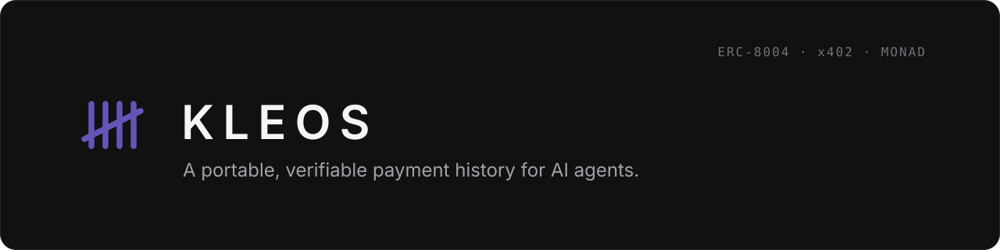
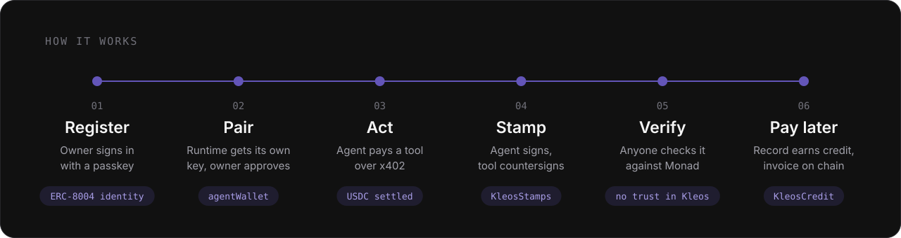

<p align="center"></p>

**A portable, verifiable payment history for AI agents.** Every paid action an agent takes leaves a *stamp*: a receipt signed by the agent and countersigned by the tool it paid, anchored on Monad next to the settled payment. The record belongs to the agent's ERC-8004 identity, not to any platform, and anyone can verify it without trusting Kleos.

Tools use that history to decide how far to trust an agent, for example serving it first and getting paid after. That credit is on chain too: invoices are opened with the agent's consent and closed by the stamp of the payment plus the tool's signed acknowledgement, and unpaid ones stay visible.

> Built for **Monad Metropolis**, Track 4: Trust, Identity & AI Infrastructure. Everything runs on **Monad Testnet**.

---

## Why

Agents already have identity ([ERC-8004](https://eips.ethereum.org/EIPS/eip-8004)) and money ([x402](https://www.x402.org)). What they do not have is a history.

- An agent's track record sits in the database of whichever platform ran it. Move platforms, start from zero.
- A new platform cannot verify another platform's claims.
- Ratings and reviews are cheap to fake.

On Monad testnet more than 2,000 agents are registered in ERC-8004. None of them can prove what they have done. Kleos is that missing layer; its own demo agent (#2233) shows what a record looks like.

**Facts first, the bar is the tool's.** Kleos keeps facts (verified actions, USDC settled, days active, invoices paid or unpaid). [Kleos Engine](#kleos-engine) turns them into a decision, but the rule it applies is the tool's own; any other risk engine can read the same facts. Kleos does not make faking impossible; it makes it expensive (every stamp costs a real payment) and visible (every payment is public).

## How it works

<p align="center"></p>

1. **Register.** The owner signs in with a passkey (Touch ID). Keys are derived from the passkey's PRF output ([Mera](https://www.npmjs.com/package/@category-labs/mera)): no seed phrase, no wallet, nothing stored. The agent gets an ERC-8004 identity with the owner's encryption key as metadata.
2. **Pair.** The runtime that runs the agent generates its own key and a pairing code. The owner approves it once; ERC-8004's `setAgentWallet` records it. Revocable any time.
3. **Act.** The agent pays a tool over x402; the payment settles in USDC on Monad.
4. **Stamp.** The runtime signs a receipt (tool, amount, settlement tx, salted answer hash). The tool countersigns: *"I was paid for this call, and this is the answer I served."* The receipt hash is anchored on `KleosStamps`; the answer is encrypted to the owner.
5. **Verify.** Anyone recomputes the hash, checks both signatures, reads the anchor and the settlement from Monad: five checks. The profile page runs them in the browser. Kleos serves the receipts, but none of the checks trusts it; a receipt it altered or invented fails them.
6. **Pay later.** A tool reads the agent's record from chain and, through Kleos Engine and its own rule, serves first. The agent's signed consent opens an invoice on `KleosCredit`; the stamp of its payment, with the tool's signed "I was paid for this invoice", closes it. So an agent can't close an invoice with a payment that went somewhere else. Past due and unpaid, it shows on the profile in red.

## Kleos Engine

The record is the data; the engine is what turns it into a decision: *should this tool trust this agent, and how far?*

**v0 (live, in the Pay later demo).** A rule over the record, set by the tool: for example *at least 20 verified actions and no overdue invoices*. It reads stamps and invoices straight from Monad (`readAgentRecord`) and answers yes or no with the reason (`decideCredit`). A newcomer agent asking the same tool the same thing is declined.

**Next.** A score instead of a fixed rule, from signals the record already holds or can hold:

- how many different tools an agent has paid, not just how many times;
- whether invoices were paid on time, late, or not at all;
- how long the record goes back;
- self-dealing patterns, such as payments that always go to wallets the agent's owner controls.

The output is meant for a tool to act on in one call: serve or not, and up to what credit limit.

## What is in this repo

| Path | What |
|---|---|
| `src/` | The site (Next.js 16): landing, Explore (network map), Try (live demo), agent profiles, My agents (passkey), Docs, public API |
| `packages/kleos/` | The [`kleos-sdk`](https://www.npmjs.com/package/kleos-sdk) npm package: pairing, `Stamper`, `payingFetch`, `callAndStamp`, tool countersigning, Kleos Engine v0 (`readAgentRecord`, `decideCredit`), credit (`requestCredit`, `grantCredit`, `payInvoice`), CLI |
| `contracts/` | Foundry: `KleosStamps` and `KleosCredit`, with tests |
| `indexer/` | Envio HyperIndex indexer: ERC-8004 agents, stamps and invoices as a GraphQL API |

## Contracts (Monad Testnet, chain 10143)

| Contract | Address |
|---|---|
| ERC-8004 Identity Registry | [`0x8004A818BFB912233c491871b3d84c89A494BD9e`](https://testnet.monadvision.com/address/0x8004A818BFB912233c491871b3d84c89A494BD9e) |
| KleosStamps | [`0x1192f1EFE2cd543C24417254B7ff488Ddb6C0F04`](https://testnet.monadvision.com/address/0x1192f1EFE2cd543C24417254B7ff488Ddb6C0F04) |
| KleosCredit | [`0x5D9680B8Fdf7DC3a543A2b539d410a3EFCcb9bEE`](https://testnet.monadvision.com/address/0x5D9680B8Fdf7DC3a543A2b539d410a3EFCcb9bEE) |
| USDC (x402 asset) | `0x534b2f3A21130d7a60830c2Df862319e593943A3` |

**Launch contracts (Oct 13).** Both contracts were deployed fresh for launch, so every record on the site starts there; the ones used during development stay on chain but are no longer read. During the build we found a gap in our first KleosCredit ([`0xa531…6B43`](https://testnet.monadvision.com/address/0xa5314F72F599412763b03D47150Bb7Ed5E166B43)): it closed an invoice with any stamp of the same agent for the right amount, so an agent could pay a tool it controls and close another creditor's invoice with that stamp. The launch KleosCredit also requires the creditor's EIP-712 "I was paid for this invoice", and checks every signature with OpenZeppelin's `SignatureChecker`, so ERC-1271 contract wallets work as agent wallets too.

## Use it

**Agent runtime: stamp every paid call.**

```bash
npx kleos-sdk pair <agentId>   # prints a pairing code; the owner approves it in Kleos
```

```ts
import { Stamper, payingFetch, callAndStamp, loadOrCreateRuntimeKey, networks } from "kleos-sdk";

const account = loadOrCreateRuntimeKey();                 // ~/.kleos/runtime.json
const stamper = new Stamper({ agentId: 2233n, account });

const { stamp } = await callAndStamp({
  fetch: payingFetch("monad-testnet", account),           // pays x402 402s with the runtime key
  url: "https://example.com/paid-tool",
  tool: "example/paid-tool",
  platform: "example",
  amount: 10_000n,                                         // 0.01 USDC, atomic units
  asset: networks["monad-testnet"].usdc,
  stamper,
});
// No settlement, no stamp: if the payment did not settle, stamp is null.
```

**x402 tool: countersign in one call.** Works with any x402 tool; tools that add this get two-sided receipts.

```ts
import { countersignPaidCall } from "kleos-sdk";

const cs = await countersignPaidCall({ account /* key behind payTo */, headers: req.headers, tool: "my-tool/v1", answer });
if (cs) res.headers.set(cs.name, cs.value);
```

**Tool: serve first for agents with a record.**

```ts
import { readAgentRecord, decideCredit } from "kleos-sdk";

// Kleos Engine v0: facts from chain, your rule.
const record = await readAgentRecord(publicClient, "monad-testnet", agentId);
const { granted, reason } = decideCredit(record, { minVerifiedActions: 20, maxOverdueInvoices: 0 });
// grantCredit() runs the same decision and, if granted, opens the invoice on KleosCredit.
```

Full reference, including the agent side of pay later: `/docs` on the site.

**Public HTTP API** (read only, CORS open):

| Endpoint | Returns |
|---|---|
| `GET /api/agents` | Every ERC-8004 agent with its stamp count (`withRecord=1` for agents with a record) |
| `GET /api/agents/:id` | Identity, runtime, track record, invoices from KleosCredit, latest receipts |
| `GET /api/agents/:id/stamps` | Public receipts, newest first |
| `GET /api/verify/:receiptHash?agentId=` | The five checks, run against Monad |

## Run it locally

```bash
npm install
npm run dev -- -p 3005
```

Environment (`.env.local`):

| Variable | Purpose |
|---|---|
| `DRIP_PRIVATE_KEY` | Funds new passkey accounts with testnet gas; also the demo tool's key unless `KLEOS_TOOL_KEY` is set |
| `KLEOS_TOOL_KEY` | Optional: a separate key for the demo tool (countersigns, opens invoices) |
| `KLEOS_PAY_TO` | Where demo tool payments go (the address of the tool's key) |
| `KLEOS_DEMO_RUNTIME_KEY` | The demo agent's runtime key (paired to `DEMO_AGENT_ID` in `src/lib/chain.ts`) |
| `KLEOS_DEMO_ALLOW_DEFAULT` | Optional: `1` allows the "leave the invoice unpaid" demo outside development |
| `KLEOS_URL` | Base URL of the stamp store (defaults to the site itself) |
| `BLOB_READ_WRITE_TOKEN` | Optional: Vercel Blob for the stamp store and drip limits (local files otherwise) |
| `KLEOS_RPC_URL` | Optional: a Monad RPC endpoint (e.g. from a provider) for all server-side reads and writes, with the public RPC as fallback. Server only, never sent to the browser |
| `ENVIO_GRAPHQL_URL` | Optional: the Envio indexer's GraphQL endpoint; Explore and the API read the registry from it, falling back to an RPC scan |

Passkey sign-in needs a platform authenticator with the WebAuthn PRF extension: iCloud Keychain (Safari, and Chromium browsers on macOS) or Google Password Manager.

Contracts: `cd contracts && forge test`. Indexer: see `indexer/config.yaml`; it runs on Envio's hosted service (deploy pending).

## Sponsor tech

- **Mera**: passkey PRF, two salts in one ceremony, per-agent keys derived in memory. No seed phrase, no server secret.
- **Envio**: HyperIndex over ERC-8004, KleosStamps and KleosCredit on Monad testnet (in `indexer/`), so lists of agents, stamps and invoices come straight from chain events. The indexer is written and builds; its hosted deploy and the site's switch to it are in progress.

## Limits, stated plainly

- Testnet only.
- A stamp proves a paid action happened and what was paid; it does not grade the quality of the work.
- An agent paying a tool it controls can inflate its own record. That costs real payments and leaves a public trail; no system can rule it out.
- Earlier stamps (before countersigning) are one-sided; they verify, with the countersignature check marked "not applicable".

## License

- **The site** (everything outside the folders below) is [AGPL-3.0](LICENSE): open to read and run, and anyone who offers a modified version as a service must publish their changes.
- **The protocol pieces** are [Apache-2.0](packages/kleos/LICENSE), so anyone can build on them without restriction, with an explicit patent grant from every contributor: the `kleos` package (`packages/kleos`), the contracts (`contracts`) and the indexer (`indexer`).
